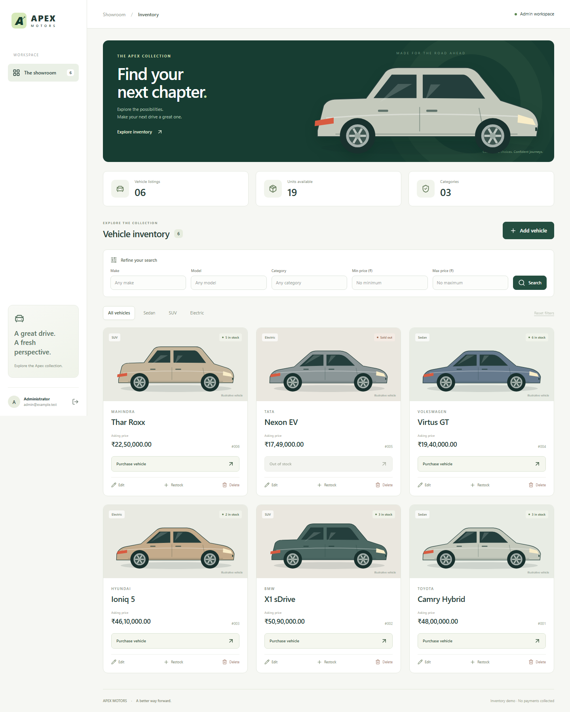
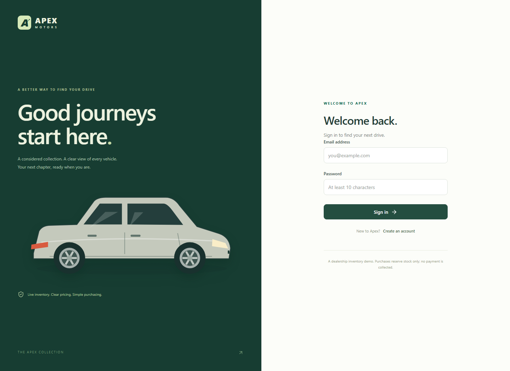

# Apex Motors — Car Dealership Inventory

A full-stack car dealership inventory kata with a React showroom, a FastAPI REST API, a persistent SQLite database, and recorded test-first development. Customers can register, browse, filter, and purchase vehicles. Administrators get inventory management controls.



## Technology and rationale

| Layer | Choice | Reason |
| --- | --- | --- |
| API | Python 3.12 + FastAPI | Small, typed endpoints; automatic OpenAPI documentation; convenient HTTP testing |
| Persistence | SQLite file, Python sqlite3 | Real durable storage without requiring a separate database server |
| Authentication | PyJWT + Argon2 via pwdlib | Signed, expiring access tokens and adaptive password hashing |
| Frontend | React + TypeScript + Vite | Typed SPA components and a fast local development workflow |
| Styling | HTML5 + CSS3 + Tailwind CSS 4 | Responsive layouts, semantic forms, reusable utility classes |
| Testing | pytest, Vitest, React Testing Library, Playwright | API integration, UI behavior, and browser-to-database workflows |

The application has no paid API dependency, external image dependency, or AI API call. AI was used during development, not at runtime. Vehicle illustrations are original SVG artwork and are labeled as illustrations rather than photographs of actual models. Example prices are fictional, expressed in INR.

## Requirements

- Python **3.12** is the tested version. Use 3.12 rather than an untested newest interpreter.
- Node.js **24** and npm; Git for preserving development history.
- Internet access for the initial dependency and browser downloads.
- Ports 8000 and 5173 available for development and browser tests.

## Restore the included Git history

If you received the ZIP, it contains both `car-dealership/` (ready-to-read source) and `car-dealership-history.bundle` (the actual Git commits). To develop with the TDD history intact, extract the ZIP, then run:

```sh
git clone car-dealership-history.bundle apex-motors
cd apex-motors
```

Do not create a new one-commit repository from the source folder if you intend to demonstrate the TDD history. If cloning a published repository, use its normal URL instead.

## Local setup — Windows PowerShell

Run these commands from the repository root. No administrator shell or PowerShell activation-policy change is needed.

```powershell
cd backend
py -3.12 -m venv .venv
.\.venv\Scripts\python.exe -m pip install -r requirements-dev.txt
.\.venv\Scripts\python.exe manage.py init
.\.venv\Scripts\python.exe manage.py create-admin --email admin@example.com
.\.venv\Scripts\python.exe manage.py seed-demo
.\.venv\Scripts\python.exe -m uvicorn app.server:app --reload --env-file .env
```

`create-admin` prompts for a password of 10–128 characters. Choose your own; no default admin password exists. `init` generates a random JWT secret and preserves an existing `.env`. `seed-demo` adds six fictional listings only when inventory is empty.

In a second PowerShell terminal, starting at the repository root:

```powershell
cd frontend
npm ci
npm run dev
```

Open **http://127.0.0.1:5173**. Register a customer in the UI, or sign in using the administrator you created. API documentation: **http://127.0.0.1:8000/docs**.

## Local setup — macOS / Linux

```sh
cd backend
python3.12 -m venv .venv
source .venv/bin/activate
python -m pip install -r requirements-dev.txt
python manage.py init
python manage.py create-admin --email admin@example.com
python manage.py seed-demo
python -m uvicorn app.server:app --reload --env-file .env
```

In a separate terminal, run `cd frontend`, `npm ci`, and `npm run dev` from the repository root.

## Configuration and persistence

`backend/.env` is generated locally and ignored by Git:

| Setting | Meaning |
| --- | --- |
| `JWT_SECRET` | At least 32 bytes; generated securely by `manage.py init`; required at server startup |
| `DATABASE_PATH` | Defaults to `data/dealership.db`, relative to the backend working directory |

SQLite runs in WAL mode with a ten-second busy timeout. Data survives server restarts. Neither the application nor its tests use `:memory:` databases. pytest uses isolated temporary files; Playwright launches a separate disposable database and never modifies a developer's inventory.

Use the same host spelling consistently (`127.0.0.1`). Vite proxies `/api` to FastAPI, so no permissive CORS configuration is needed. Access tokens last one hour and stay in React memory: reloading the page requires signing in again. Signing out clears the client token; issued tokens otherwise remain valid until expiry. Roles are read from the database on every request so role changes apply to existing tokens.

## Production build, served locally

```sh
cd frontend
npm ci
npm run build
cd ../backend
python -m uvicorn app.server:app --env-file .env --host 127.0.0.1 --port 8000
```

On Windows, use `.\.venv\Scripts\python.exe` instead of `python`. Open **http://127.0.0.1:8000**. FastAPI serves the built SPA and API from one origin. `npm run preview` alone does not proxy the API; use this combined-server approach for a working production preview.

For external deployment, provide HTTPS and a persistent writable volume for SQLite. A platform with an ephemeral filesystem will lose the database. This package is not deployed, and no live deployment URL is claimed.

## API contract

All vehicle endpoints require `Authorization: Bearer <token>`.

| Method | Route | Access / behavior |
| --- | --- | --- |
| POST | `/api/auth/register` | Public; creates a customer and returns a token; role input is rejected |
| POST | `/api/auth/login` | Public; JSON email/password; returns token and safe user profile |
| GET | `/api/auth/me` | Authenticated profile |
| GET | `/api/health` | Public health check |
| POST | `/api/vehicles` | Authenticated; add a listing with initial stock |
| GET | `/api/vehicles` | Authenticated; all listings, including sold-out ones |
| GET | `/api/vehicles/search` | Authenticated; combined make/model/category/price filters |
| PUT | `/api/vehicles/{id}` | Authenticated; replace descriptive fields and price, preserve stock |
| DELETE | `/api/vehicles/{id}` | Admin only |
| POST | `/api/vehicles/{id}/purchase` | Authenticated; reduce stock by exactly one |
| POST | `/api/vehicles/{id}/restock` | Admin only; add the supplied positive integer quantity |

Create body:

```json
{"make":"Toyota","model":"Camry","category":"Sedan","price":"3500000.50","quantity":2}
```

Update body contains `make`, `model`, `category`, and `price`. **Do not send `quantity` on PUT**: inventory has dedicated operations to prevent stale edit forms from resetting stock. Restock body: `{"quantity":3}`. Purchase has no body and always buys one unit. Deletion returns 204 with no body.

Search parameters: `make`, `model`, `category`, `min_price`, `max_price`. Text filters use case-insensitive substring matching and combine with AND. Prices are inclusive; malformed or reversed ranges return 422. Results sort by newest ID first. No pagination is implemented for this small kata dataset.

Prices accept up to two decimal places, range from 0 to 999999999, are stored as integer paise, and return as decimal strings. Stock is an integer from 0 to 1,000,000. Empty labels, unknown body fields, negative values, non-finite prices, and fractional stock are rejected.

Response codes: 201 created; 200 success; 204 deleted; 401 missing/invalid/expired authentication; 403 unauthorized role; 404 missing vehicle; 409 duplicate email/out of stock/stock capacity conflict; 422 invalid input.

### Permission interpretation

The kata explicitly marks only deletion and restocking as admin-only API operations. Accordingly, authenticated customers can call create/update through the API, while the **UI exposes management forms to admins only**, as requested. If the evaluator intends admin-only create/update at the API too, change those two dependencies and their role tests together. Initial quantity on creation remains allowed; changing existing stock is restricted to purchase/restock.

## Architecture and concurrency

`main.py` wires the routes and dependencies; `schemas.py` validates input/output; `auth.py` handles credentials/tokens; `database.py` owns connections and user persistence; `vehicles.py` owns parameterized vehicle queries and stock updates. `errors.py` keeps business failures independent of FastAPI, with HTTP translation at the application boundary. `manage.py` provides local administration.

A purchase is one conditional SQL statement, not a read-then-write sequence:

```sql
UPDATE vehicles SET quantity=quantity+?
WHERE id=? AND quantity+? BETWEEN 0 AND 1000000
RETURNING *;
```

SQLite serializes writes, and the predicate checks available stock within the update. The concurrency test launches eight requests for one remaining unit and verifies exactly one success, seven conflicts, and zero final stock. Concurrent restocking is also tested for lost updates. Money is converted to integer paise before SQL storage to avoid floating-point rounding.

## Tests and reports

See [TEST_REPORT.md](TEST_REPORT.md) for actual results and scope. Raw output, JUnit XML, historical red/green logs, and screenshots are included under `docs/`. The GitHub Actions workflow is configured but has not been run remotely yet.

Backend (from `backend/`, with its virtual environment active):

```sh
python -m pytest --cov=app --cov-branch --cov-fail-under=90 --cov-report=term-missing --cov-report=html:../docs/coverage/backend --junitxml=../docs/backend-junit.xml
```

Frontend (from `frontend/`):

```sh
npm run test:coverage
npm run build
npx playwright install chromium
npm run test:e2e
```

**Before browser tests:** stop the development servers using ports 8000 and 5173. The suite starts its own servers. Its `python` command must resolve to the backend virtual environment. On Windows, in the terminal running the browser suite:

```powershell
$env:Path = (Resolve-Path ..\backend\.venv\Scripts).Path + ";" + $env:Path
npm run test:e2e
```

On Linux, Playwright may require `npx playwright install --with-deps chromium`. `npx playwright show-report` opens its HTML report. Browser tests also regenerate screenshots. The screenshot accounts use `.test` email addresses and exist only inside the disposable test database.

### Actual TDD history

- `5b3224c`: authentication contracts, 11 failing tests.
- `a29f148`: authentication implementation, 11 passing tests.
- `6970240`: inventory contracts, 37 failing tests and 12 passing tests.
- `64f178d`: vehicle API implementation, 49 passing tests.
- `3161e3e`: domain/HTTP error separation with 49 tests still passing.
- `3150175`: vehicle-card contracts, four failing tests and one passing test.
- `1f8b0c0`: complete frontend and five passing card tests.

Later regression and browser tests were added after those implementations. These are not represented as test-first cycles. The failing-state logs were captured before implementation; history was not backdated or reconstructed.

## My AI Usage

### Tools used

ChatGPT's coding assistant (Codex) was used in this session for planning, code generation, tests, debugging, documentation, and local verification.

### How AI was used

- Translate the supplied kata into a stack choice, API contracts, permission interpretation, and acceptance tests.
- Write failing backend tests first, run them, then implement registration, login, authorization, filtering, and atomic inventory changes.
- Refactor domain failures away from HTTP response handling and rerun existing tests.
- Build the React/Tailwind UI, original SVG vehicle illustrations, and administrator dialogs.
- Generate and execute regression, component, and real-browser integration tests; inspect screenshots and adjust the mobile hero.
- Prepare local setup, CI configuration, a test report, and an interview checklist.

The implementation was authored for this request. It was not copied from another project repository. Framework documentation informed integration choices; installed open-source libraries retain their own licenses.

### Reflection and ownership

AI shortened the initial implementation and helped enumerate negative cases such as role escalation, duplicate emails, malformed tokens, overselling, and stale stock edits. It also introduced review work: browser installation required a compatible pinned test runner, and TypeScript identified an invalid option in a test helper. Tests and actual tool output, rather than generated claims, were used to establish results.

### AI attribution and raw logs — submission blockers

This workspace disables AI co-author trailers. Consequently, the generated commits **do not meet the kata's AI co-authorship requirement**, despite the disclosure above. 
## Screenshots

- [Desktop inventory](docs/screenshots/desktop.png)
- [Mobile inventory](docs/screenshots/mobile.png)
- [Login screen](docs/screenshots/login.png)



## Scope and next steps

This kata implements stock purchasing, not payments, customer orders, invoicing, or VIN-level individual vehicle tracking. Password reset, refresh-token rotation, login rate limiting, inventory audit records, and pagination are outside the current implementation. A public production launch would need those decisions plus operational backups, HTTPS, and deployment-specific security review.

Before submitting, follow [SUBMISSION_CHECKLIST.md](SUBMISSION_CHECKLIST.md): preserve Git history, complete attribution and raw logs, add your own reflection, and publish to a public repository. No public repository URL or deployment is included yet.
